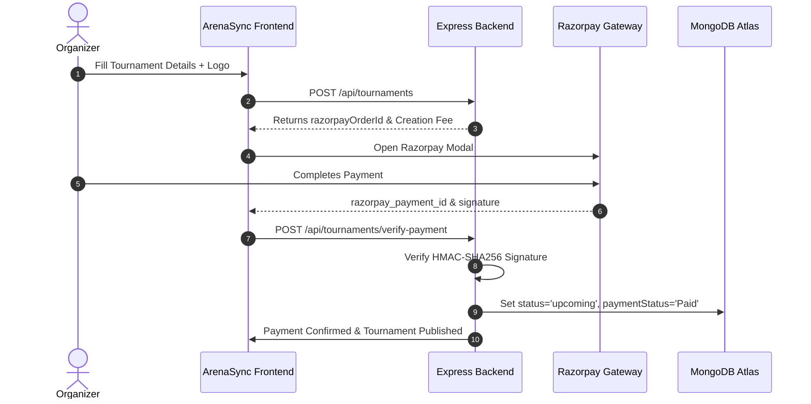
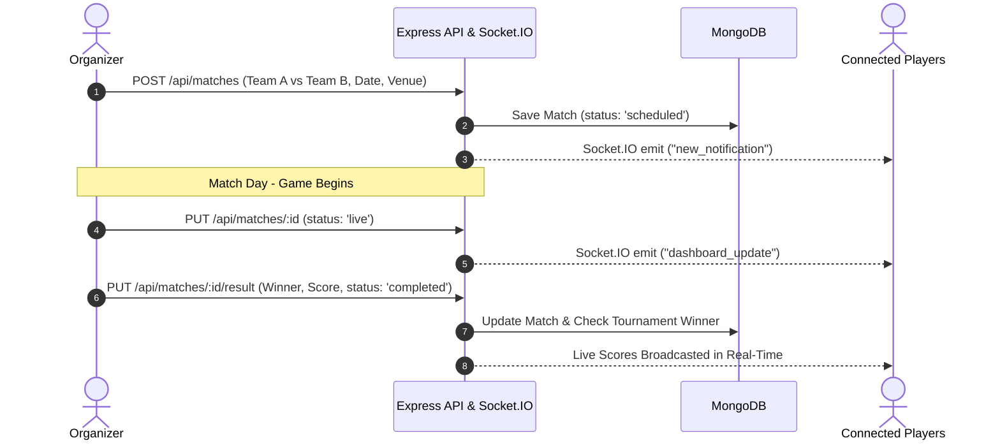

# 🏟️ ArenaSync — Real-Time Sports Tournament & Arena Management Platform

[](https://nodejs.org/)
[](https://expressjs.com/)
[](https://react.dev/)
[](https://vitejs.dev/)
[](https://www.mongodb.com/)
[](https://socket.io/)
[](https://razorpay.com/)
[](https://cloudinary.com/)
[](LICENSE)

> **ArenaSync** (SportSync Arena) is a full-stack, enterprise-grade sports tournament management and arena operations ecosystem. Engineered to streamline the entire tournament lifecycle—from dual-channel user authentication and team registration to dynamic match scheduling, live score broadcasting, sponsor collaborations, Razorpay payment processing, and automated prize pool distribution.

---

## 📌 Table of Contents

- [Overview](#-overview)
- [System Architecture](#-system-architecture)
- [Key Features by Role (RBAC)](#-key-features-by-role-rbac)
- [Workflow Diagrams](#-workflow-diagrams)
- [Tech Stack](#-tech-stack)
- [Project Directory Structure](#-project-directory-structure)
- [Data Models & Schema](#-data-models--schema)
- [REST API Reference](#-rest-api-reference)
- [Real-Time WebSocket Engine](#-real-time-websocket-engine)
- [Environment Configuration](#-environment-configuration)
- [Getting Started & Local Setup](#-getting-started--local-setup)
- [Database Migration Utility](#-database-migration-utility)
- [Deployment Guide](#-deployment-guide)
- [Contributors & Academic Context](#-contributors--academic-context)

---

## 📖 Overview

Organizing academic and regional sports tournaments typically suffers from fragmented communication, manual paper-based fixtures, opaque prize payouts, and disconnected payment verification. 

**ArenaSync** solves these challenges by unifying all tournament operations into a synchronized, real-time web platform with:
- **Role-Based Access Control (RBAC)** across 5 dedicated roles: `player`, `coach`, `organizer`, `sponsor`, and `admin`.
- **Dual-Channel Verification**: Email OTP (via Brevo / Nodemailer) + Phone SMS OTP (via Fast2SMS).
- **Payment Lifecycle Management**: Integrated Razorpay order creation and HMAC-SHA256 signature verification for tournament creation fees, player join fees, and team registration charges.
- **Automated Prize Distribution Engine**: Calculates, allocates, and audits winner and runner-up payouts from total tournament prize pools.
- **Live Notifications & Analytics**: Low-latency Socket.IO room subscriptions for instant alerts and interactive Chart.js / Three.js analytics.

---

## 🏗️ System Architecture

```
                                  +---------------------------------------+
                                  |         React 18 + Vite Client        |
                                  | (Role-Based Dashboards, Lucide, Charts)|
                                  +-------------------+-------------------+
                                                      |
                                          HTTP / REST | WebSocket (Socket.IO)
                                                      v
                                  +---------------------------------------+
                                  |         Express 5 + Node Server       |
                                  | (Auth Guard, Validators, Multer, Sockets)
                                  +-----+---------+---------+---------+---+
                                        |         |         |         |
                  +---------------------+         |         |         +-------------------+
                  |                               |         |                             |
                  v                               v         v                             v
+-------------------------------+  +-------------------+  +--------------+  +-------------------------------+
|      MongoDB Database         |  |   Razorpay API    |  |  Cloudinary  |  |   Brevo / Fast2SMS Engines    |
| (Mongoose ODM / Atlas Cluster)|  | (Orders & Sign.)  |  | (CDN Images) |  |   (Email & SMS Delivery)      |
+-------------------------------+  +-------------------+  +--------------+  +-------------------------------+
```

---

## 👥 Key Features by Role (RBAC)

### 🛡️ 1. Platform Administrator (`admin`)
- **System Governance**: Full oversight of platform users with abilities to approve, block, activate, or soft-delete accounts.
- **Financial Audit & Overrides**: Review all Razorpay transactions across tournaments, registrations, and sponsorship packages; trigger admin payment status overrides when needed.
- **Prize Pool Oversight**: Execute and audit automated prize disbursements to tournament champions and runners-up.
- **Resource Management**: Create, update, and manage official sports catalogs and sporting venues/facilities.
- **Platform Analytics**: Real-time analytical dashboard with revenue breakdown, active participation metrics, and exportable reports.

### 🏆 2. Tournament Organizer (`organizer`)
- **Tournament Creation**: Define tournament name, sport, venue, team registration fees, prize pool, participant caps, and rulebooks.
- **Creation Fee Payment**: Integrated Razorpay checkout to activate tournament visibility.
- **Bracket & Match Scheduler**: Generate multi-round match fixtures, assign dates and venues, and maintain game rounds.
- **Live Scoring & Results**: Update live match statuses (`scheduled` ➔ `live` ➔ `completed`) and record final scores and winning teams.
- **Sponsorship Coordination**: Review and link incoming sponsor contracts to hosted events.

### ⚽ 3. Player (`player`)
- **Discovery**: Explore public upcoming and ongoing tournaments with detailed criteria, schedules, and prize pools.
- **Team Management**: Create teams as captain, manage member rosters, and accept or reject prospective player applications.
- **Join Teams**: Search for existing teams, submit join requests, and handle join-fee payments seamlessly.
- **Tournament Registration**: Register whole rosters into tournaments with instant payment confirmation.
- **Live Dashboard**: Real-time match schedule alerts, personal registrations tracker, and tournament leaderboards.

### 📋 4. Coach (`coach`)
- **Squad Organization**: Review player registrations, build tournament-ready rosters, and track tactical match schedules.
- **Dedicated Coach Dashboard**: Tailored analytics on squad performance, match history, and tournament placements.

### 💼 5. Sponsor (`sponsor`)
- **Sponsor Portal**: View open tournaments seeking financial backing and submit custom sponsorship proposals.
- **Self-Sponsorship Checkout**: Direct Razorpay integration to fund tournaments with automated tier assignment.
- **Branding Visibility**: Upload brand assets and track sponsor recognition across event pages.

---

## 🔄 Workflow Diagrams

### 1. Tournament Creation & Registration Flow



### 2. Match Scheduling & Live Scoring Flow



---

## 💻 Tech Stack

### Client-Side (Frontend)
| Layer | Technology | Purpose |
|---|---|---|
| **Core Framework** | React 18.2 + Vite 7 | Fast Single Page Application (SPA) architecture |
| **Routing** | React Router v6 | Nested layouts, protected routes, and role-based redirects |
| **Real-Time Client** | Socket.IO Client 4.8 | Low-latency bi-directional event subscriptions |
| **Visuals & 3D** | Three.js, Recharts, Chart.js | Dynamic 3D graphics and statistical dashboards |
| **Icons & Motion** | Lucide React, Framer Motion | Modern UI micro-interactions and iconography |
| **HTTP Client** | Axios 1.13 | Centralized interceptors, auth headers, and error handling |

### Server-Side (Backend)
| Layer | Technology | Purpose |
|---|---|---|
| **Runtime & Server** | Node.js + Express 5 | High-performance RESTful API micro-architecture |
| **Database & ODM** | MongoDB + Mongoose 9 | Document-oriented schemas with validation & timestamps |
| **Authentication** | JWT (jsonwebtoken) + bcryptjs | Stateless auth tokens and salted password hashing |
| **Input Validation** | express-validator 7 | Request sanitization and strict validation chains |
| **Media Pipeline** | Multer + Cloudinary Storage | Multi-part uploads directly streamed to Cloudinary CDN |
| **Payment Engine** | Razorpay Node SDK | Cryptographic payment creation and signature verification |
| **Email & SMS OTP** | Brevo API, Nodemailer, Fast2SMS | Multi-channel OTP delivery for account verification |
| **WebSockets** | Socket.IO Server 4.8 | Real-time notifications and synchronized analytics |

---

## 📂 Project Directory Structure

```plaintext
Arenasync/
├── Backend/
│   ├── config/                     # Configuration modules (Cloudinary, DB, etc.)
│   ├── controllers/                # Request handling & business logic
│   │   ├── analyticsController.js  # Dashboard aggregations & real-time stats
│   │   ├── authController.js       # Register, login, OTP & password reset
│   │   ├── matchController.js      # Fixtures, scheduling & live results
│   │   ├── notificationController.js# User notifications & cleanup
│   │   ├── paymentController.js    # Razorpay orders, verification & audit
│   │   ├── prizeDistributionController.js # Prize allocation logic
│   │   ├── profileController.js    # User profiles & avatar uploads
│   │   ├── registrationController.js # Tournament team registrations
│   │   ├── sponsorController.js    # Sponsor management & self-sponsorship
│   │   ├── sportController.js      # Sports catalog management
│   │   ├── teamController.js       # Team rosters, captains & join requests
│   │   ├── tournamentController.js # Tournament lifecycle & creation fees
│   │   ├── userController.js       # Admin user governance
│   │   └── venueController.js      # Sporting venue operations
│   ├── middleware/                 # Custom Express middlewares
│   │   ├── authMiddleware.js       # JWT extraction & identity verification
│   │   ├── roleMiddleware.js       # Strict RBAC permission enforcement
│   │   ├── upload.js               # Multer-Cloudinary file upload handlers
│   │   └── validateRequest.js      # express-validator result formatter
│   ├── models/                     # Mongoose Schemas
│   │   ├── EmailOtp.js             # Email verification tokens
│   │   ├── Match.js                # Match details, rounds & scores
│   │   ├── notification.js         # In-app notifications
│   │   ├── PendingUser.js          # Pre-verification user state
│   │   ├── PrizeDistribution.js    # Calculated payout records
│   │   ├── Registration.js         # Tournament team entries
│   │   ├── Sponsor.js              # Sponsorship tiers & banners
│   │   ├── Sport.js                # Sport metadata & roster sizes
│   │   ├── Team.js                 # Teams, captain ID & members
│   │   ├── Tournament.js           # Tournament specifications & fees
│   │   ├── Transaction.js          # Razorpay payment ledger
│   │   ├── User.js                 # User credentials, roles & contacts
│   │   └── Venue.js                # Venue details & capacities
│   ├── routes/                     # REST API route declarations
│   ├── utils/                      # Helper services (Email, SMS, Prize calculation)
│   ├── validators/                 # express-validator schemas for all entities
│   ├── .env.example                # Sample environment variables
│   ├── migrate.js                  # Idempotent DB migration script (Local -> Atlas)
│   ├── package.json                # Server dependencies & scripts
│   └── server.js                   # Express application entry & Socket.IO server
│
├── Frontend/
│   ├── public/                     # Static assets & favicon
│   ├── src/
│   │   ├── adminside/              # Admin-specific pages & management modules
│   │   │   ├── AdminDashboard.jsx  # Main administrative hub
│   │   │   ├── AdminPayments.jsx   # Financial transaction audit table
│   │   │   ├── AdminUsers.jsx      # User status & role management
│   │   │   ├── AnalyticsDashboard.jsx # Real-time platform metrics
│   │   │   ├── Reports.jsx         # Exportable platform summary reports
│   │   │   ├── SportManagement.jsx # Add/update sport types
│   │   │   └── VenueManagement.jsx # Venue configuration
│   │   ├── component/              # Shared reusable UI elements (Cards, Modals)
│   │   ├── components/             # Navigation bars, headers & footers
│   │   ├── context/                # AuthContext & global state providers
│   │   ├── layouts/                # RoleLayout & view wrappers
│   │   ├── routes/                 # AdminRoute & NonOrganizerRoute guards
│   │   ├── screen/                 # Public, Player & Organizer screens
│   │   │   ├── Events.jsx          # Public tournament browsing
│   │   │   ├── Home.jsx            # Landing page with hero & live stats
│   │   │   ├── Leaderboard.jsx     # Team rankings & top performers
│   │   │   ├── Login.jsx           # Secure authentication portal
│   │   │   ├── MyTeamDashboard.jsx # Captain roster management
│   │   │   ├── OrganizerDashboard.jsx # Organizer control center
│   │   │   ├── OrganizerMatches.jsx# Score submission & fixture generator
│   │   │   ├── RegisterWithVerification.jsx # Dual-channel signup flow
│   │   │   ├── Schedule.jsx        # Complete tournament match timetable
│   │   │   ├── SponsorDashboard.jsx# Sponsor brand management
│   │   │   └── TournamentDetails.jsx# Detailed tournament overview
│   │   ├── services/               # Razorpay & API client wrappers
│   │   ├── static/                 # CSS modules & styling assets
│   │   ├── utils/                  # axiosConfig, socket connection & validators
│   │   ├── App.jsx                 # Master application routing
│   │   ├── main.jsx                # React DOM entry point
│   │   └── index.css               # Base stylesheet
│   ├── .env.example                # Frontend environment configuration
│   ├── package.json                # Client dependencies & scripts
│   ├── vercel.json                 # Vercel deployment & rewrite configuration
│   └── vite.config.js              # Vite build setup
└── README.md                       # Master Documentation
```

---

## 🗄️ Data Models & Schema

| Collection | Key Attributes | Description |
|---|---|---|
| **Users** (`User`) | `name`, `email`, `phoneNumber`, `role`, `status`, `sports`, `isPhoneVerified`, `emailVerified`, `profileImage` | Core identity model supporting 5 distinct user roles and verification statuses. |
| **Tournaments** (`Tournament`) | `eventName`, `sportId`, `venueId`, `prizePool`, `startDate`, `endDate`, `status`, `teams`, `winner`, `runnerUp`, `teamRegistrationFee`, `paymentStatus` | Tournament lifecycle and financial parameters. |
| **Teams** (`Team`) | `teamName`, `captain`, `sport`, `members`, `logo`, `tournamentId`, `status` | Team rosters and tournament enrollments. |
| **Matches** (`Match`) | `tournamentId`, `teams` (Array of 2), `matchDate`, `venueId`, `round`, `status`, `result` (`winnerTeamId`, `score`) | Match fixtures with round management and live scoring. |
| **Registrations** (`Registration`) | `tournamentId`, `teamId`, `userId`, `status`, `paymentStatus`, `paymentAmount` | Links teams and players to tournaments upon fee clearance. |
| **Transactions** (`Transaction`) | `razorpayOrderId`, `razorpayPaymentId`, `userId`, `amount`, `paymentType`, `status` | Immutable audit log of all financial interactions on the platform. |
| **PrizeDistributions** (`PrizeDistribution`) | `tournamentId`, `prizePool`, `winnerPercentage`, `runnerUpPercentage`, `payouts`, `status` | Records automatic and manual prize distributions. |
| **Sponsors** (`Sponsor`) | `name`, `brandName`, `tournamentId`, `tier`, `amountPaid`, `logo`, `paymentStatus` | Tracks event sponsorships and corporate brand placements. |
| **Venues** (`Venue`) | `name`, `address`, `city`, `capacity`, `facilities` | Physical facilities available for hosting matches. |
| **Sports** (`Sport`) | `name`, `category`, `playersPerTeam`, `rulesSummary` | Supported sports disciplines and squad limits. |

---

## 🔌 REST API Reference

### 🔐 Authentication (`/api`)
| Method | Endpoint | Access | Description |
|---|---|---|---|
| `POST` | `/api/register` | Public | Register new account (creates unverified user record) |
| `POST` | `/api/check-email` | Public | Check if an email address is already taken |
| `POST` | `/api/send-email-otp` | Public | Dispatch email verification code via Brevo / Nodemailer |
| `POST` | `/api/verify-email-otp` | Public | Verify OTP code and activate account |
| `POST` | `/api/login` | Public | Authenticate user and receive signed JWT token |
| `POST` | `/api/forgot-password` | Public | Initiate password reset request with OTP |
| `POST` | `/api/reset-password` | Public | Reset password using verified reset OTP |

### 🏆 Tournaments (`/api/tournaments`)
| Method | Endpoint | Access | Description |
|---|---|---|---|
| `GET` | `/api/tournaments/public` | Public | List all public tournaments with filtering |
| `GET` | `/api/tournaments/public/:id` | Public | Retrieve detailed overview of a single tournament |
| `GET` | `/api/tournaments/my-tournaments` | Organizer | Get tournaments created by the logged-in organizer |
| `POST` | `/api/tournaments` | Organizer / Admin | Create new tournament (initiates Razorpay fee) |
| `POST` | `/api/tournaments/verify-payment`| Organizer / Admin | Verify Razorpay payment and activate tournament |
| `PUT` | `/api/tournaments/:id` | Organizer / Admin | Update tournament details, dates, or rulebooks |
| `DELETE` | `/api/tournaments/:id` | Admin | Delete or archive a tournament |

### ⚽ Teams & Rosters (`/api/teams`)
| Method | Endpoint | Access | Description |
|---|---|---|---|
| `GET` | `/api/teams/public` | Public | List all active public teams |
| `GET` | `/api/teams/:id` | Public | Fetch team roster and captain details |
| `GET` | `/api/teams/my-teams` | Player / Coach | Fetch teams managed or joined by user |
| `POST` | `/api/teams` | Player / Coach | Create new squad and register as captain |
| `POST` | `/api/teams/:id/apply` | Player | Request to join an existing team roster |
| `PUT` | `/api/teams/:id/approve-player`| Captain / Coach | Approve or reject a prospective player request |
| `POST` | `/api/teams/pay-join` | Player | Initialize player join fee transaction |
| `POST` | `/api/teams/verify-join` | Player | Confirm player join fee payment |
| `DELETE` | `/api/teams/:id/leave` | Player | Leave current team roster |

### ⚔️ Matches & Fixtures (`/api/matches`)
| Method | Endpoint | Access | Description |
|---|---|---|---|
| `GET` | `/api/matches/public/upcoming` | Public | Get list of upcoming scheduled fixtures |
| `GET` | `/api/matches/public/completed`| Public | Get results of completed games |
| `GET` | `/api/matches/tournament/:id` | Public | Fetch all matches scheduled under a tournament |
| `GET` | `/api/matches/my-schedule` | Player / Coach | Fetch customized timetable for user's matches |
| `POST` | `/api/matches` | Organizer / Admin | Schedule a new match between two teams |
| `PUT` | `/api/matches/:id/result` | Organizer / Admin | Submit match score and determine game winner |
| `DELETE` | `/api/matches/:id` | Organizer / Admin | Cancel or remove scheduled match fixture |

### 💳 Payments & Transactions (`/api/payments`)
| Method | Endpoint | Access | Description |
|---|---|---|---|
| `GET` | `/api/payments/get-key` | Authenticated | Fetch public Razorpay Client Key ID |
| `POST` | `/api/payments/create-order` | Authenticated | Create an authentic Razorpay Order ID |
| `POST` | `/api/payments/verify-payment` | Authenticated | Verify HMAC signature against order and payment ID |
| `GET` | `/api/payments/transactions` | Authenticated | View personal transaction history |
| `GET` | `/api/payments/admin/all` | Admin | View comprehensive system-wide payment ledger |
| `POST` | `/api/payments/admin/override` | Admin | Manually force transaction state override |

### 📊 Real-Time Analytics (`/api/analytics`)
| Method | Endpoint | Access | Description |
|---|---|---|---|
| `GET` | `/api/analytics/stats` | Organizer / Admin | Aggregated metrics (users, tournaments, gross revenue)|
| `GET` | `/api/analytics/organizer-stats` | Organizer / Admin | Stats scoped to organizer's hosted events |
| `GET` | `/api/analytics/player-dashboard`| Player | Personal career matches, wins, and win-rate |
| `GET` | `/api/analytics/sponsor-dashboard`| Sponsor | Total capital invested and event reach statistics |

---

## 📡 Real-Time WebSocket Engine

ArenaSync relies on **Socket.IO** for live, bidirectional communication without page polling.

### Socket Handshake & Rooms
When a client connects, they emit their user ID to register their socket:
```javascript
// Client sends registration
socket.emit("register", userId);

// Organizer/Admin joins analytics room
socket.emit("register-analytics", { userId });
```

### Server Events Emitted
| Event Name | Target Room / Client | Payload | Trigger Condition |
|---|---|---|---|
| `new_notification` | Specific User Socket (`io.to(socketId)`) | `{ title, message, type, link, createdAt }` | Player joins team, application accepted, match scheduled |
| `dashboard_update` | Global Broadcast (`io.emit`) | `{ type: "tournament_created" \| "prize_distributed" }` | Tournament status changes, results posted, prize sent |
| `analytics_update` | Analytics Room (`socket.join("analytics-room")`)| Updated real-time counters & chart dataset | New payment verified, new user registered |

---

## ⚙️ Environment Configuration

### Backend Configuration (`Backend/.env`)
Create a `.env` file in the `Backend/` directory based on the template below:

```env
# ==========================================
# SERVER & DATABASE CONFIGURATION
# ==========================================
PORT=5000
MONGO_URI=mongodb://localhost:27017/ArenaSync
# For MongoDB Atlas:
# MONGO_URI=mongodb+srv://<username>:<password>@cluster0.mongodb.net/ArenaSync?retryWrites=true&w=majority
JWT_SECRET=super_secret_jwt_passphrase_here

# ==========================================
# CORS & FRONTEND CLIENT
# ==========================================
FRONTEND_URL=http://localhost:5173

# ==========================================
# CLOUDINARY MEDIA CLOUD (Banners & Logos)
# ==========================================
CLOUDINARY_CLOUD_NAME=your_cloudinary_cloud_name
CLOUDINARY_API_KEY=your_cloudinary_api_key
CLOUDINARY_API_SECRET=your_cloudinary_api_secret

# ==========================================
# RAZORPAY PAYMENT GATEWAY
# ==========================================
RAZORPAY_KEY_ID=rzp_test_your_key_id
RAZORPAY_KEY_SECRET=your_razorpay_secret_key

# Organizer Tournament Creation Fee (in paise; 50000 = ₹500.00)
ORGANIZER_TOURNAMENT_CREATION_FEE=50000

# ==========================================
# EMAIL DELIVERY (Brevo API & SMTP)
# ==========================================
BREVO_API_KEY=xkeysib-your-brevo-api-key
BREVO_SENDER_EMAIL=your_verified_sender@domain.com
BREVO_SENDER_NAME=ArenaSync

# Optional Nodemailer Fallback
EMAIL_USER=your_email@gmail.com
EMAIL_PASS=your_gmail_app_password

# ==========================================
# SMS OTP GATEWAY (Optional)
# ==========================================
FAST2SMS_API_KEY=your_fast2sms_api_key
```

### Frontend Configuration (`Frontend/.env`)
Create a `.env` file in the `Frontend/` directory:

```env
# URL pointing to the running Express backend API
VITE_API_URL=http://localhost:5000/api

# WebSocket URL for live Socket.IO connection
VITE_SOCKET_URL=http://localhost:5000
```

---

## 🚀 Getting Started & Local Setup

### 1. Prerequisites
Ensure you have the following installed on your local machine:
- **Node.js** (v18.0.0 or higher recommended)
- **npm** (v9+) or **pnpm** / **yarn**
- **MongoDB** (Local instance running at `localhost:27017` or a MongoDB Atlas URI)
- Git

### 2. Clone the Repository
```bash
git clone https://github.com/Jainam249/ArenaSync.git
cd ArenaSync
```

### 3. Backend Setup
1. Open a terminal and navigate to the backend directory:
   ```bash
   cd Backend
   ```
2. Install server dependencies:
   ```bash
   npm install
   ```
3. Populate the `Backend/.env` file with your credentials (see template above).
4. Start the backend server:
   ```bash
   # Production mode
   npm start

   # Development mode with nodemon auto-reload
   npx nodemon server.js
   ```
   *The backend should output: `🚀 Server running on port 5000` and `✅ MongoDB Connected`.*

### 4. Frontend Setup
1. In a new terminal window, navigate to the frontend directory:
   ```bash
   cd Frontend
   ```
2. Install client dependencies:
   ```bash
   npm install
   ```
3. Verify `Frontend/.env` has `VITE_API_URL=http://localhost:5000/api`.
4. Launch the Vite development server:
   ```bash
   npm run dev
   ```
5. Open your browser and navigate to **`http://localhost:5173`**.

---

## 🔁 Database Migration Utility

The repository includes a dedicated, resilient database migration script (`Backend/migrate.js`) designed to safely transfer data from a local MongoDB instance to a cloud-hosted MongoDB Atlas cluster.

### Safety Features:
- **Idempotent Upsert**: Checks existing `_id` before inserting; prevents duplicate record errors.
- **Insert-Only Guarantee**: Never performs delete, drop, or replace actions on target databases.
- **DNS Fail-Safe**: Overrides local DNS servers with Google (`8.8.8.8`) and Cloudflare (`1.1.1.1`) to prevent SRV lookup timeouts on restricted campus networks.
- **Credential Masking**: Automatically masks database passwords in migration console logs.

### Running Migration:
```bash
cd Backend
node migrate.js
```

---

## 🌐 Deployment Guide

### Frontend on Vercel
The frontend includes a pre-configured `vercel.json` with SPA route rewrites:
```json
{
  "$schema": "https://openapi.vercel.sh/vercel.json",
  "rewrites": [
    {
      "source": "/(.*)",
      "destination": "/index.html"
    }
  ]
}
```
1. Push your repository to GitHub.
2. Import the project into your [Vercel Dashboard](https://vercel.com).
3. Set the **Root Directory** to `Frontend`.
4. Configure environment variables in Vercel:
   - `VITE_API_URL`: Your deployed backend URL (e.g. `https://api.yourdomain.com/api`)
   - `VITE_SOCKET_URL`: Your deployed backend WebSocket root (e.g. `https://api.yourdomain.com`)
5. Click **Deploy**.

### Backend on Render / Railway / Cloud VPS
1. Set the root directory to `Backend`.
2. Set Build Command to `npm install`.
3. Set Start Command to `node server.js`.
4. Add all environment variables from `Backend/.env`.
5. Ensure `FRONTEND_URL` matches your deployed Vercel domain (e.g., `https://arenasync-tau.vercel.app`) to ensure CORS headers permit requests.

---

## 🛡️ Security & Validation

- **Password Hashing**: `bcryptjs` with auto-generated salt rounds to ensure credentials cannot be cracked.
- **Sanitized SQL/NoSQL**: Input parameters are parsed through strict `express-validator` rules to prevent NoSQL injection.
- **CORS Allowlist**: Configured with strict origin checks supporting local and production frontends while silently rejecting unauthorized cross-origin calls.
- **HMAC Payment Signatures**: Razorpay payment verification re-computes `crypto.createHmac("sha256", secret)` before confirming orders or updating transaction balances.
- **Role Enforcement Guards**: Middlewares ensure users cannot manipulate payload IDs to impersonate organizers, join teams as non-eligible roles, or view restricted admin ledgers.

---

## 👨‍💻 Contributors & Academic Context

This platform was developed as part of **IT 645: Web and Mobile Development** for **Dhirubhai Ambani University (DAU)**.

| Contributor | GitHub Profile | Role & Contributions |
|---|---|---|
| **Jainam Shah** | [@Jainam249](https://github.com/Jainam249) | Full-Stack Architecture, Frontend Dashboards, Routing, UI/UX & Socket.IO Client |
| **Meet Sheth** | [@Meetsheth25](https://github.com/Meetsheth25) | Backend Architecture, Entity Validators, API Endpoints, Payment Gateway & DB Migration |

---

## 📄 License

This project is licensed under the [ISC License](LICENSE). Feel free to use, modify, and distribute this codebase for educational and development purposes.
